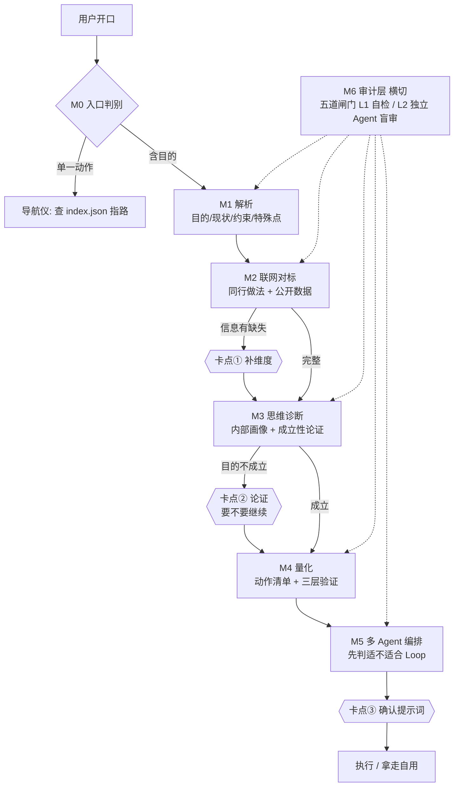

# Gateway — 需求进去，可执行路径出来

**你说一句话，Gateway 判断这条路走不走得通，走不通就当场告诉你，走得通就把它拆成 AI 能严格执行的多 Agent 提示词。**

[](https://creativecommons.org/licenses/by/4.0/)

---

## 一句话解释

Gateway 有两副面孔。你说的第一句话决定走哪副：

| 面孔 | 触发条件 | 干什么 |
|------|---------|--------|
| **导航仪** | 需求是**单一动作**（"把这个 pdf 转 docx"、"总结这篇文章"） | 查本地 Skill 索引 → 指路 → 完事 |
| **管道** | 需求含**目的**（"我想在县城搭个回收团队，3 个月跑通第一单"） | 走 M1→M5，产出可直接执行的多 Agent 提示词 |

---

## 管道全景



**只有三个卡点**（要停下来问你）。**五道闸门**（自动过的，不问你，但不通过不许往下走）。

---

## 六个模块

| 模块 | 干什么 | 停顿 |
|---|---|---|
| **M0 入口判别** | 你要的是结果还是动作？判错后面全白跑 | — |
| **M1 解析** | 提取目的 / 现状 / 约束 / **特殊点**。禁止想方案 | — |
| **M2 联网对标** | 联网搜同行做法与公开数据，校验信息完不完整 | 🚦 缺 ≥2 项时停 |
| **M3 思维诊断** | 内部判断你的思维惯性，论证目的成不成立、有没有更优路径 | 🚦 不成立时停 |
| **M4 量化** | 拆成带验收标准和验证方式的动作清单 | — |
| **M5 编排** | 写成多 Agent loop 提示词，落文件 | 🚦 你确认后才执行 |
| **M6 审计层** | 横切上面五个模块，每个出口卡一道闸门 | — |

### 几个设计上的硬决定

**M2 强制联网。** 靠记忆编同行案例是编，用户一追问"这数据哪来的"就穿。搜不到就明说稀缺，改用相邻领域基准并标注不确定度。

**M3 只取判定结构，不取表达风格。** 判定方法参考鲁大魔连麦诊断框架（904 条真实对话蒸馏）：L0 五闻 → 4 信号 → 自知锚定（**合并取最低**，不取平均）→ 13 型匹配 → 问题有效性三分类。但**不做心理按摩、不踹用户**，输出保持中性：结论 + 理由 + 代价 + 备选。

**代价必须会中断周期。** "没人看""质量低""不涨粉"这类不是代价，那是周期内的正常波动，写它有安慰剂效应，会盖住真风险。真正的代价是链条断点、退不回得来、资源耗尽点、天花板这类——碰上了得停下来重想办法。

**M6 分两级。** 自己审自己等于没审：

| 级别 | 谁审 | 用在哪 |
|---|---|---|
| L1 自检 | 执行者自己按清单过 | 闸门 1、闸门 4 |
| **L2 独立审计** | **另开一个 Agent，不共享上下文，只读产物** | 闸门 2、3、5 |

三条让它真正起作用的规则：**「未验证」= FAIL**；不采信"已完成""已检索"这类自述；审计员不许帮着补做。九种反模拟红名单见 `references/module-6-auditor.md`。

---

## 安装

```bash
git clone https://github.com/wang-youxin/gateway.git
cp -r gateway/ ~/.workbuddy/skills/
```

首次使用需要建索引（索引记录你本地装了哪些 Skill，M5 生成提示词时靠它注入能力池）：

```bash
node ~/.workbuddy/skills/gateway/refresh-index.js
```

装/卸任意 Skill 之后都要重建，否则 Gateway 不知道你有什么能力。

---

## 用法

```
# 直接说需求，它自己判走哪条道
"帮我做个落地页"
"我在县城想搭个回收团队，5 万启动，3 个月跑通第一单"

# 显式调用
/gateway 帮我找能做数据可视化的工具

# 管理命令
/gateway refresh   重建 Skill 索引
/gateway audit     对当前模块强制加一道独立审计
```

运行过程会在你的工作目录留下痕迹：

```
{cwd}/.workbuddy/gateway/<slug>/
├── state.md              五模块状态，跨轮次续跑靠它
├── thinking-internal.md  M3 内部画像，禁止贴给用户
├── audit-log.md          每道闸门的判定与证据
└── agent-prompt.md       M5 产出，你要看的就是这个
```

会话压缩、上下文丢了、第二天回来——读 `state.md` 接着跑。

---

## 文件结构

```
gateway/
├── SKILL.md                        主流程与判定规则
├── refresh-index.js                索引重建脚本
├── index.json                      Skill 索引（本地运行后填充）
├── README.md
└── references/
    ├── module-0-router.md          入口判别
    ├── module-2-benchmark.md       联网对标
    ├── module-3-thinking.md        思维诊断
    ├── module-4-quantify.md        量化
    ├── module-5-prompt-spec.md     多 Agent 提示词规格
    ├── module-6-auditor.md         审计层与反模拟红名单
    └── skill-matching.md           导航仪路径
```

> `index.json` 里的条目含**本机绝对路径**，属于你自己的运行时数据，**不要提交进公开仓库**。仓库里这份是空模板。

---

## 兼容性

Claude Code / Codex / Cursor / WorkBuddy，以及任何支持 `SKILL.md` 的框架。

---

## 许可

CC BY 4.0 — 自由使用、修改、分发，署名注明来源。
